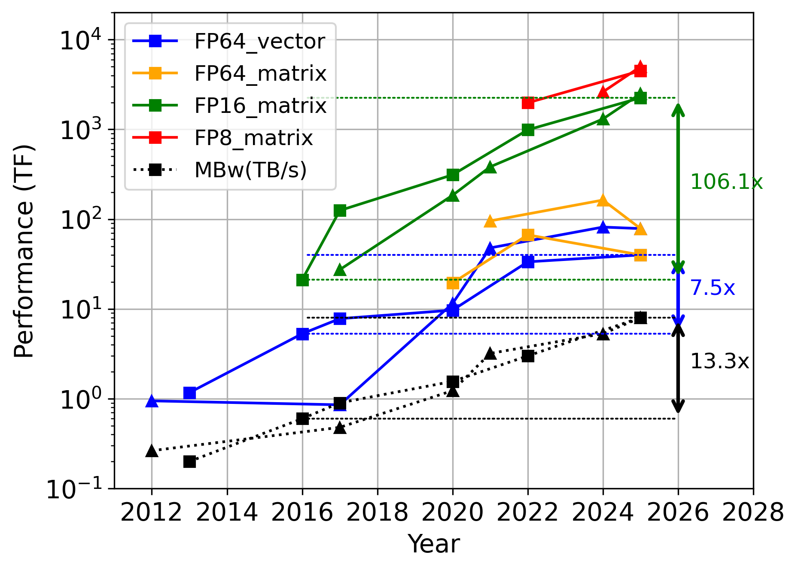

# Second Workshop on Mixed- and Adaptive-Precision Numerics for Scientific Computing (MxP4S)

## IPDPS 2027, Seattle, Washington, USA

[Important dates](dates.html) | [Topics of interest](topics.html) | [Format and schedule](format.html) | [Organizers](orgranizers.html)

Thank you for your interest in the MxP4S workshop! The second MxP4S workshop will be held in conjunction with the 41st IEEE International Parallel & Distributed Processing Symposium, [IPDPS 2027](https://www.ipdps.org/), in Seattle, Washington, USA. IPDPS 2027 will take place June 1–5, 2027, with the exact workshop date and schedule to be announced.

MxP4S 2027 will feature presentations of six selected papers, invited talks from distinguished researchers and practitioners, and opportunities for audience discussion. We welcome researchers interested in numerical methods, scientific simulations, mixed and adaptive precision, and high-performance computing.

New and upcoming HPC platforms provide disproportionately high throughput for low-precision arithmetic, while their double-precision throughput is increasing more slowly or even plateauing.

This trend is driven largely by the demands of artificial intelligence model training and inference. Meanwhile, the computational requirements of scientific applications continue to grow. In many scientific domains, the low-precision capabilities of modern hardware cannot be used directly because of the accuracy and stability requirements of first-principles simulations. Many data-driven scientific methods also do not rely on neural networks or gradient descent and therefore do not automatically benefit from low-precision computational throughput.

It is therefore important to establish principles and practical techniques that help computational scientists use low-precision hardware while understanding and controlling its effect on application accuracy. These advances can improve time to solution, memory and storage requirements, energy efficiency, the productivity of scientific software teams, and the operating costs of HPC facilities.

We also have an opportunity to redefine precision in scientific computing in terms of adaptive precision rather than one or two fixed numerical formats. This can lead to a sustainable computing paradigm that delivers high performance while maintaining reliable results on current and emerging hardware architectures. Determining how this paradigm should support different computational motifs and scientific domains remains an important research challenge.
